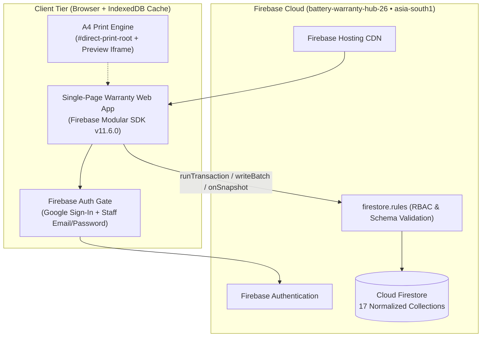
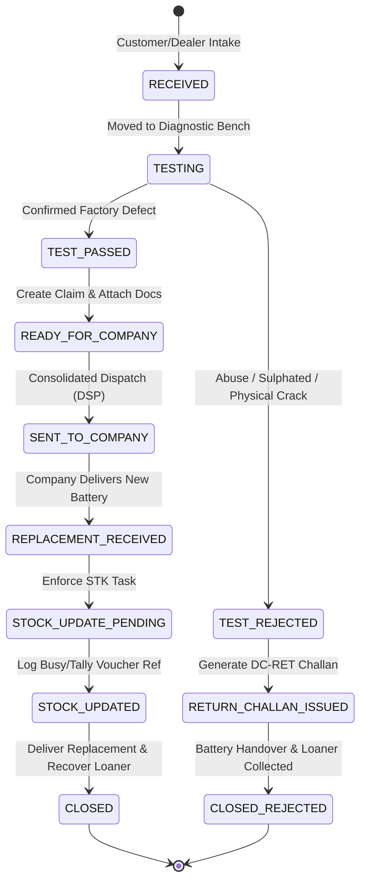

# ⚡ Battery Warranty & Claim Management System

> **100% Firebase-Native Operational Platform for Indian Battery Distributors, Service Centers & Authorized Dealers.**
> Powered by **Firebase Authentication**, **Cloud Firestore (`asia-south1`)**, and **Firebase Hosting** — zero reliance on Google Sheets.

[](https://battery-warranty-hub-26.web.app)
[-ffca28?style=for-the-badge&logo=firebase)](https://console.firebase.google.com/project/battery-warranty-hub-26/firestore)

---

## 📌 Executive Summary

Managing automotive and inverter battery warranties in India is notoriously complex. Distributors handle thousands of claims annually across brands like **Amaron**, **Exide**, **Tata Green**, **Luminous**, and **Livguard**. Key operational challenges include:
- **Lost Service/Loaner Batteries:** Temporary batteries given to customers tracked with availability pools, customer locks, manual blocking, and rotation counts.
- **Lost Warranty Batteries & Serial Discrepancies:** Strict 3-way isolation between original, loaner, and replacement serials.
- **Uncoordinated Company Dispatches:** Multi-battery consignments sent with GST Rule 55 statutory challans (`DC-COM`) and LR docket tracking.
- **Inventory Desynchronization:** Replacement batteries received from manufacturers enter the warehouse and block claim closure until physical stock vouchers in accounting software (**Tally / Busy ERP**) are logged.

The **Battery Warranty & Claim Management System** runs natively on **Firebase**:
- **Firebase Auth** (Google Sign-In + Email/Password staff portal restricted to authorized accounts in `authorized_staff`)
- **Cloud Firestore (`asia-south1` / Mumbai)** with strict `firestore.rules` schema validation and real-time IndexedDB offline persistence
- **Firebase Hosting** (`https://battery-warranty-hub-26.web.app`)

---

## 🚀 Key Features

* **Firebase Real-Time Cloud Sync & Offline Cache:**
  - Live `onSnapshot` listeners across all operational collections with multi-tab IndexedDB persistence (`persistentLocalCache`).
* **Staff Access Control (Firebase Auth + RBAC):**
  - Authorized staff email allowlist (`ADMIN`, `OPERATOR`, `TESTER`) managed directly inside Settings → Staff Access.
* **Service / Loaner Battery Stock, Blocking & Rotation Pool:**
  - Track `AVAILABLE`, `ASSIGNED` (customer-locked), and `BLOCKED` units, assignment history logs, and total rotation counts.
* **Dynamic Battery Models Master:**
  - Add, edit, and remove battery models, capacities, guarantee windows, and pro-rata months live in Firestore.
* **Reliable A4 Print-Ready Document Engine:**
  - Isolated `#direct-print-root` + iframe print preview across Intake Slips, Claim Forms, Return Challans (`DC-RET`), and Company Dispatch Challans (`DC-COM`).
* **Mandatory Accounting & Stock Reconciliation Engine:**
  - Enforced both in client state and in `firestore.rules` (`status == 'CLOSED'` requires `stock_status == 'UPDATED'`).
* **Claim Attachments in Firestore:**
  - Auto-compressed invoices, warranty cards, and diagnostic photos saved directly in `claim_documents`.

---

## 🏗️ System Architecture



---

## 🔄 Lifecycle & State Progression



---

## 📁 Repository Structure

```text
battery-warranty-manager/
├── .clasp.json.example       # Example clasp configuration
├── .gitignore                # Guards credentials and private clasp IDs
├── LICENSE                   # MIT License
├── README.md                 # System overview and portfolio documentation
├── firebase.json             # Firebase Hosting, Firestore & Auth providers config
├── .firebaserc               # Default Firebase project (battery-warranty-hub-26)
├── firestore.rules           # Staff RBAC & schema validation security rules
├── firestore.indexes.json    # Firestore composite/field indexes config
├── public/index.html         # Compiled Firebase Hosting SPA bundle
├── index.html                # Compiled standalone bundle
├── apps-script/              # Source UI components & modular legacy GAS reference
│   ├── Index.html            # SPA shell, modals, auth gate, Firebase v11.6.0 SDK
│   ├── app.html              # Client controller, Firestore transaction engine & print engine
│   ├── styles.html           # UI styles & isolated @media print stylesheets
│   └── *.gs                  # Legacy Apps Script service modules (archived reference)
├── scripts/                  # Build, migration, and automated test suite
│   ├── build-github-pages.js # Compiles UI components into index.html & public/index.html
│   ├── migrate-sheet-to-firestore.js # One-time legacy Google Sheet -> Firestore importer
│   └── run-full-system-test.js # End-to-end automated system & logic test runner
└── docs/                     # Engineering documentation
    ├── architecture.md       # Technical design and architectural decisions
    ├── deployment.md         # Administrator guide
    ├── sheet-schema.md       # Legacy schema definitions
    └── workflow.md           # State machines, transition tables, & diagrams
```

---

## 🛠️ Build, Verification & Deployment

### Running Build & Automated Test Suite
```bash
# Compile modular HTML/CSS/JS components into public/index.html and index.html:
npm run build

# Run full Firebase architecture, Firestore rules, and business logic test suite:
npm test
```

### Deploying to Firebase
```bash
# Deploy Firestore security rules, Auth config, and Hosting together:
npx -y firebase-tools@latest deploy --project battery-warranty-hub-26
```

### One-Time Legacy Migration
```bash
# Dry-run or import historical records from Google Sheet into Cloud Firestore:
node scripts/migrate-sheet-to-firestore.js --dry-run
```

---

## 🌐 Live Firebase Resources

* **Firebase Hosting Web App:** [https://battery-warranty-hub-26.web.app](https://battery-warranty-hub-26.web.app)
* **Cloud Firestore Console:** [https://console.firebase.google.com/project/battery-warranty-hub-26/firestore](https://console.firebase.google.com/project/battery-warranty-hub-26/firestore)
* **Firebase Authentication Console:** [https://console.firebase.google.com/project/battery-warranty-hub-26/authentication/users](https://console.firebase.google.com/project/battery-warranty-hub-26/authentication/users)

---

## 📄 License
This project is licensed under the [MIT License](LICENSE).
